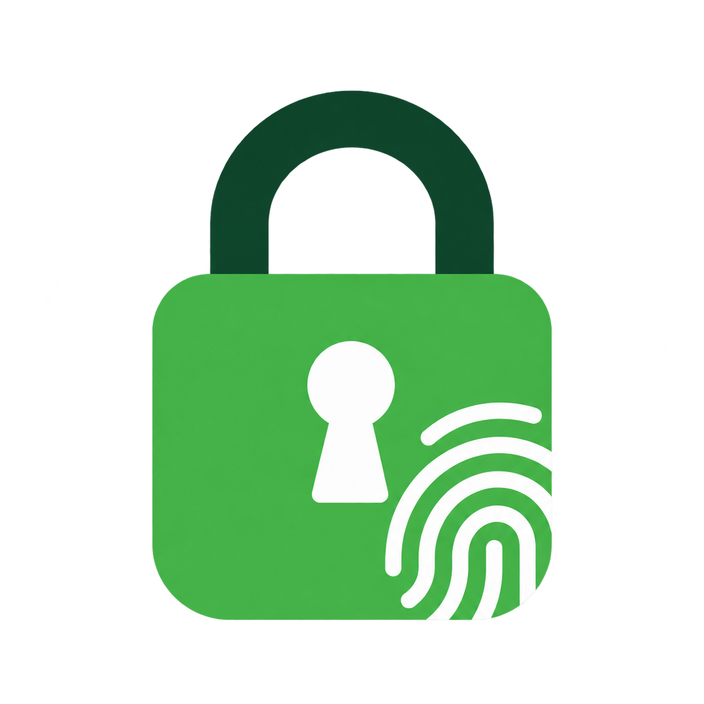
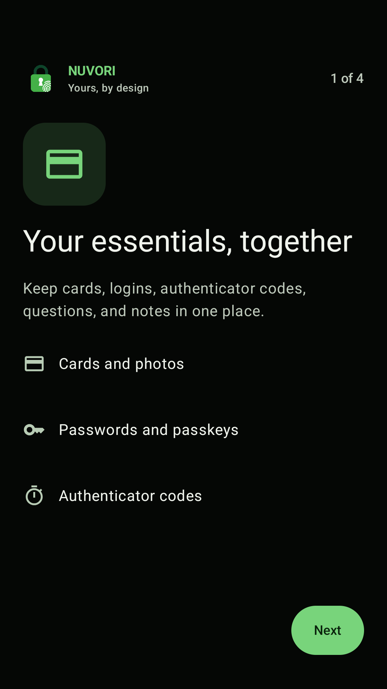
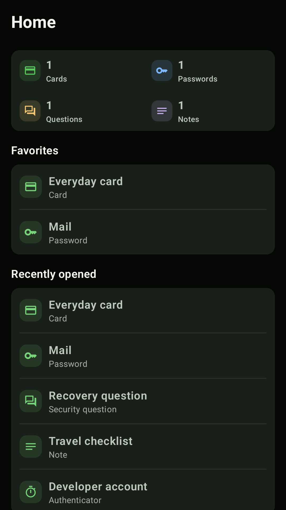
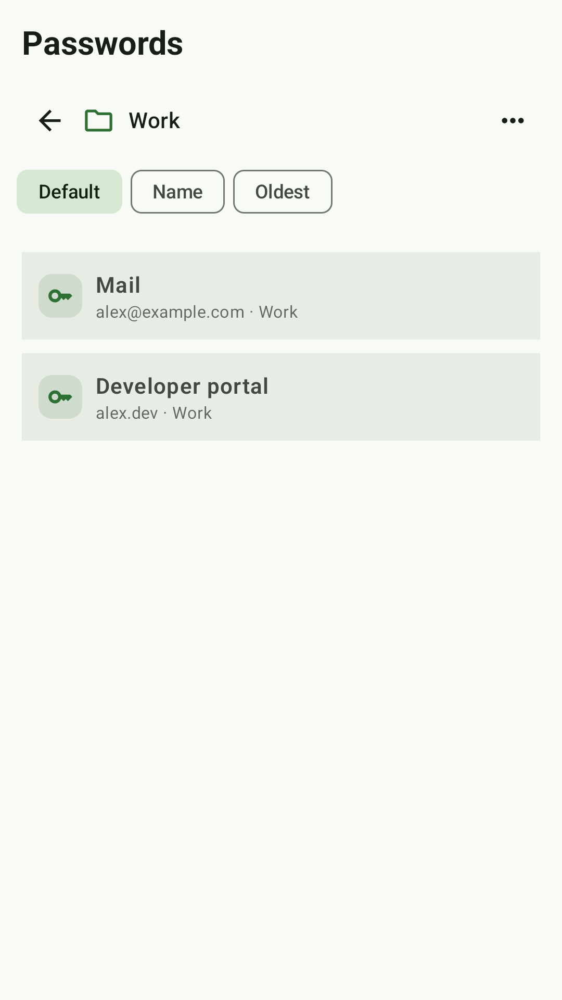
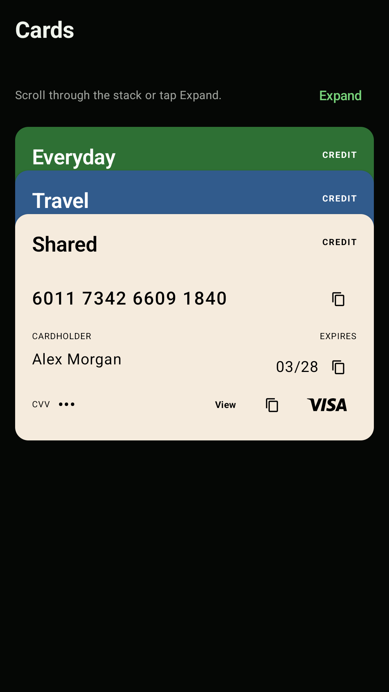
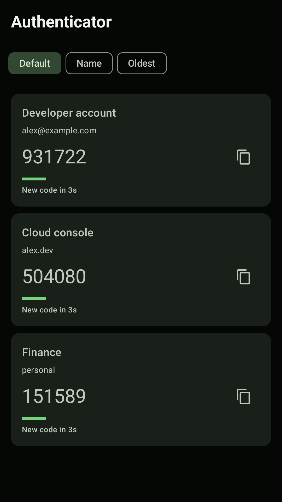
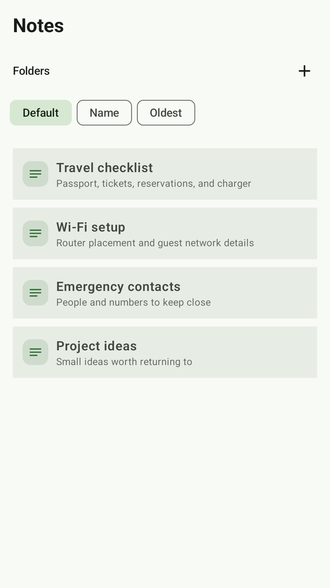
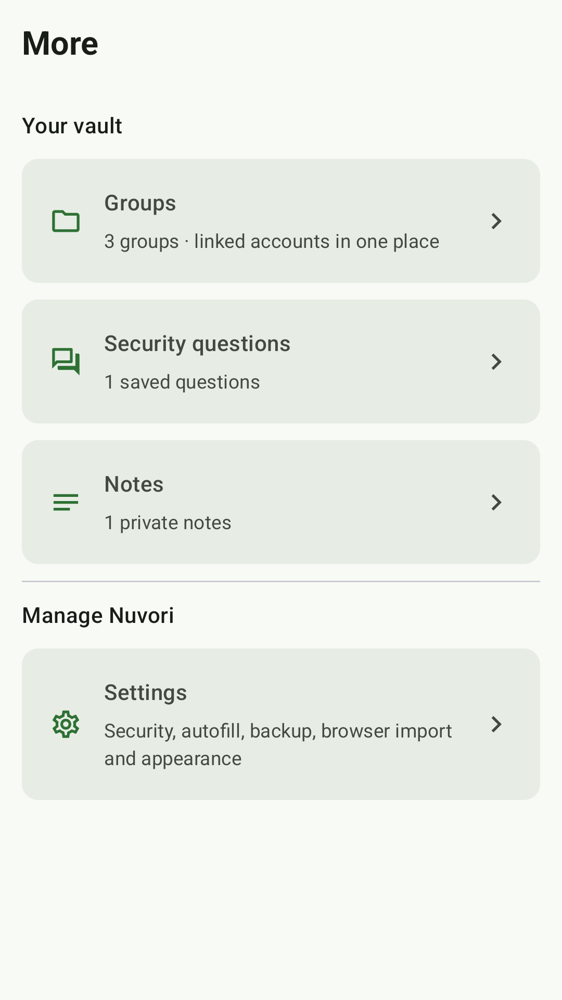

# Nuvori

**Yours, by design.**

An Android app for cards, passwords, authenticator codes, passkeys, security questions, notes, and photos. Vault data works offline; optional device sync uses your local Wi-Fi or your own Google Drive.

No Nuvori account, server, or ads. Paired devices receive encrypted vault changes over your local Wi-Fi. When they are apart, they can also sync through your own Google Drive, which stores only encrypted files.

<p align="center">
  
</p>

## Product tour

<p align="center">
  
  
  
</p>

<p align="center">
  
  
  
  
</p>

The screenshots contain synthetic demonstration data only.

## Download

**[Download Nuvori 2.2.10 phone preview APK](downloads/nuvori-v2.2.10-phone.apk?raw=true)**

Requires **Android 10 or newer**. [SHA-256 checksums](downloads/SHA256SUMS.txt) · [Release notes](docs/RELEASE-2.2.10.md) · [Privacy policy](docs/privacy-policy.html)

Open the download on your phone and allow installation from your browser or file manager when Android asks. No PC connection is needed.

**Moving from v1.5.2 or earlier:** v1.6.0 uses the new package `com.application.private_vault` and installs as a separate app. Export an encrypted backup from the old app, restore it into the new app, and check your records before removing the old installation. Later updates using the same package and signing identity can install over this version.

For Google Play, use the [2.2.10 phone AAB](downloads/nuvori-v2.2.10-phone.aab?raw=true) and [release build guide](docs/PUBLISHING.md). An AAB is for store upload; install the APK directly on a phone.

Wear OS companion version 2.1.2, code 360012: [watch APK](downloads/nuvori-v2.1.2-watch.apk?raw=true), [watch AAB](downloads/nuvori-v2.1.2-watch.aab?raw=true), and [setup guide](docs/WATCH-COMPANION.md). Install the watch APK on the watch. For local setup, the phone and watch apps must share the package name and signing certificate; these download builds match.

## Features

- **First-run guide:** four short pages explain saved items, local security, and device sync. Choose a new vault, join an existing vault, restore a backup, or import browser passwords.
- **Cards:** credit/debit cards, number, cardholder, expiry, CVV, notes, and photos. Pick any color with a hue and brightness picker or an exact #RRGGBB value, reuse a color from your other cards, and browse all cards in a stacked or expanded view. The color syncs with Windows, which shows it too. Copy individual fields; revealing or copying a CVV requires biometric authentication.
- **Passwords and security questions:** save login details and answers, with notes and photos.
- **Linked logins:** generate a 24-character password locally and link an existing authenticator to a login. View its code alongside the login without duplicating the setup key. Removing the login keeps the authenticator.
- **Optional autofill:** authorize native apps in a login's editor or save its exact HTTPS website URL, then choose Nuvori as your Autofill provider. Unlock and select an account to fill a username/password or a linked code on a separate code screen. Native apps require the saved package and signing identity. Website filling is restricted to verified stable release certificates of Chrome, Brave, Edge, Firefox, Firefox Focus and Klar, Samsung Internet, Vivaldi, Opera, Opera Mini, DuckDuckGo, Naver Whale and Yandex, and an exact HTTPS origin match; browsers other than Chrome and Brave are not device-tested yet. A login form inside a frame fills for the frame's own HTTPS origin, as in Chrome's password manager, so an ad or embed from another origin no longer blocks the page; a form whose fields span two origins, or sit in or under a non-HTTPS page, is left alone. A sign-in page shown inside an app (an embedded browser) still fills only for that app's package and signing identity: the picker shows the site the app says it displays, lists logins saved for that site first, and asks you to confirm, because the app receives what is filled. Browser support depends on Android autofill being enabled in the browser. The unlock suggestion shows the app icon and name, including inside compatible keyboards; short screens use a regular Android suggestion. Nuvori recognizes sign-in fields by autofill hints, field names, an app's field IDs and hint text, and fills the form you are using even when the page also has a search or newsletter form. Ambiguous forms are left alone. The account picker shows which app or website is asking, with a search box at the top that ranks linked logins first. In Chrome and Brave it also lists logins saved for another page of the same site (by the bundled Public Suffix List, so `a.github.io` and `b.github.io` stay separate); one tap fills such a login once without linking it, and keyboard suggestions still require an exact link. For any other login you confirm the destination, then choose **Fill and link** or **Fill once**. Where Nuvori can't confirm the site (a browser it doesn't recognize, a page that isn't HTTPS such as a router's admin page, or a page in an app with frames), it still offers **Unlock to fill** in the login field: the picker says it can't confirm the page, you search for the login, and it fills once after you confirm. Such pages are never linked and never offer to save. After the picker or a keyboard suggestion fills a login with a linked authenticator, the next code screen in the same app or on the same site (another subdomain counts, `a.github.io` and `b.github.io` do not) shows that login first under **Just signed in** for 3 minutes: unlock and tap **Fill code**. Nuvori keeps only the login's id and the destination in memory for this, never the code. Copying the code to the clipboard is an optional fallback, off by default, under Autofill and codes. Native-app and browser Save/Update prompts require a separate vault unlock and confirmation, show whether the password is new, changed, or already saved, and let you name the login. App sign-in screens without a username field can be saved too; you type the account name. A lone numeric PIN screen is not offered. Choosing this provider replaces your current password autofill provider; the code tile remains available if you prefer to keep Bitwarden.
- **Contact details:** save your name, email, phone and address as an Autofill details entry. Address and contact forms in apps and supported browsers show **Unlock to fill your details**; unlock, pick one, and Nuvori fills only the fields the form asks for (a lone email or phone box is left to sign-in). Turn this off with **Offer to fill contact details**, or turn on **Offer saved details without vault unlock** to fill from an encrypted device copy without unlocking.
- **Card autofill:** payment forms in apps and supported browsers show **Unlock to fill a card**. Unlock, pick a card (each shown in its own color with its last four digits), and Nuvori fills only the card fields the form asks for: the number (also split into 4-digit boxes), the name or first and last name, and the expiry as one field (MM/YY, MM/YYYY or MMYY, from the field's hint) or as month and year boxes or drop-downs. The security code fills only while **Also fill the security code** is on, and asks for your fingerprint if Nuvori was unlocked over a minute ago. In browsers, the card fields must share one https origin (a hosted payment frame counts). A page shown inside an app fills for that app, and the picker warns that the app receives the card. Where Nuvori can't confirm the site (an http page, a browser it doesn't recognize), you can still fill a card from the card field after the same warning. Gift, loyalty and membership card numbers are not treated as payment cards. Turn this off with **Offer to fill cards** under Autofill and codes.
- **Password import:** import common browser and password-manager CSV files, or an unencrypted Bitwarden JSON export, under Settings > Backup and import. Supported CSV columns cover Chrome, Brave, Edge, Firefox, Safari, 1Password, LastPass, Dashlane, and Bitwarden exports. Repeated rows are consolidated, exact matches are skipped, and changed passwords are shown for review. Choose whether to keep saved passwords or replace only their password fields; names, notes, folders, photos, and linked codes remain intact. The original export contains readable passwords; delete it after verifying the import.
- **Authenticator:** generate TOTP codes offline. Scan a setup QR, import a QR image, or enter a setup key. Supports SHA1/SHA256/SHA512, 6–8 digits, and configurable intervals. The phone's clock must be correct. SMS, push approvals, HOTP, and Google Authenticator transfer QR codes are not supported.
- **Groups:** keep a bank's cards, logins, questions, notes, and codes together. An entry can belong to several groups. Deleting a group keeps its entries.
- **Folders:** organize passwords, questions, and notes inside their own categories. Folders appear before unfiled items, and entry cards show their folder. Cards use the full stack and can still belong to Groups. Deleting a folder keeps its entries. Folders and links are included in encrypted backups.
- **Quick copy tile:** add the Quick copy tile from More > Settings. Unlock, pick Passwords, TOTP, Cards or Questions, and tap a field (username, password, linked code, card number, expiry, name, CVV or answer) to copy it. After one copy, the other fields of that item stay in a silent notification for 3 minutes, so you can paste them one by one on a sign-in or payment page without opening the tile again. The notification holds no values, is hidden on the lock screen, needs an unlocked device, and ends on screen-off, swipe-away or Lock now. The picker remembers the last category and follows the same 24-hour fingerprint rule.
- **App-linked codes:** choose Linked apps when editing an authenticator account. With **Suggest codes for the previous app** on, the tile suggests accounts for the last app that asked Nuvori to fill a login or code in the past 5 minutes, with no extra permission. If another app is your Autofill provider, optional Usage access does this instead. Codes start masked, with Copy, Show/Hide, and Show all controls. App links are included in encrypted backups. Browser websites cannot be identified this way.
- **Photos:** full-resolution capture and original-file import, encrypted thumbnails, crop, rotate, cover selection, and zoom. Imported originals remain outside the vault.
- **Device sync:** pair up to six mobile devices and two Windows PCs on a reachable local network. Devices discover one another and can exchange or relay signed changes directly. Windows must be unlocked for automatic sync. Entries and photos sync through an encrypted local connection. The Android devices page starts with the sync status, last check time, and **Sync now**, then shows problems, your devices, the Automatic sync switch and check interval, pairing, and a Danger zone for leaving the group. Status colors mean the same everywhere: green checked, blue in progress, amber waiting, red needs attention. Keep an encrypted backup while testing this preview.
- **Sync when Nuvori opens:** each time you open Nuvori, it checks paired devices on this Wi-Fi and Google Drive once, also while automatic sync is paused and while the vault is locked; received changes apply after you unlock. Opening it again within a minute does not start another check, and finding no device nearby shows no warning. Turn it off under Android devices > Automatic sync.
- **Google Drive sync (optional):** when your devices are not on the same Wi-Fi, connect your own Google Drive under **Settings > Devices & sync**. Nuvori uses only its hidden app folder, encrypts every change and photo before upload, and checks the same signatures as Wi-Fi sync. Connect the same Google account on every device. First pairing still needs the same Wi-Fi.
- **Windows sync preview:** copy the vault to an unlocked Nuvori Windows vault over an encrypted local connection. Scan the phone's QR on the PC or use **Copy link**. If the PC cannot reach the phone, show a QR in Windows Sync and choose **Scan Windows QR** on the managing phone. Enter the phone's master password in Windows and confirm the matching code on both devices. Windows keeps its existing local items. Later edits and photos sync in both directions when Windows connects to the phone. This repository supplies the Android build. Get the Windows installer from the [Nuvori for Windows releases](https://github.com/santoshkanumuri/vault_apk_windows/releases/latest).
- **Home:** favorites, recently opened entries, expiry warnings, and quick add. Search across entry types, usernames, questions, card last four digits, folders, groups, tags, and notes. Passwords, answers, CVVs, full card numbers, and authenticator keys stay out of search.
- **Clear feedback:** saving, updating, deleting, copying, and sync actions show a short colored confirmation. Messages never include passwords, codes, or card numbers.
- **Appearance:** light mode or a pure black dark mode, with layouts for phones and larger screens.
- **Colors:** 16 accents and 8 backgrounds, synced to paired devices on Nuvori 2.2.4 or newer. Pick them in Settings, Appearance.
- **Google Drive backup:** optional encrypted backups to a hidden folder in your own Google Drive, every hour, day, week or month while Nuvori is unlocked. Each phone keeps its two newest backups. On a new phone, choose Restore a backup, then Find backups in Google Drive, and enter the master password. The restored vault does not join any sync group. Settings > Backup and import.
- **Optional NFC:** off by default. Start a scan from the card form to fill readable details, then review before saving. Not every card exposes its details. NFC does not provide the printed CVV or make payments.

The bottom tabs are **Home, Cards, Passwords, Codes, and More**. Groups, Security questions, Notes, and Settings are under More.

Settings groups its pages into Security, Autofill and passkeys, Sync, Backup and data, App, and Support. Each row shows its current status, such as whether Nuvori is the Autofill service or how many devices are paired.

Signup and password-change forms with new-password hints or a clearly named confirmation field can generate a password locally. Confirm **Save new login and fill** to save it before filling. The generated login keeps the selected account's groups and authenticator link; the old login stays unchanged. Submit the website form yourself and confirm it accepted the new password before removing an older login.

Passkeys require Android 14 or newer. Enable Nuvori under **Settings > Passkeys**. Requests from the verified stable browsers listed above (Chrome, Brave, Edge, Firefox, Samsung Internet, Vivaldi, Opera, DuckDuckGo and others) use the exact HTTPS website host; browsers other than Chrome and Brave are not device-tested yet. Native Android app requests use the app's signing certificate as their origin; the confirmation screen shows the app and requested site. The app's server must accept that origin. Passkeys use ES256. Parent-domain and related-origin browser requests, importing existing passkeys, and extra passkey extensions are not supported. Some apps only offer selected passkey providers. Some browsers also require Nuvori as the Autofill provider with third-party autofill enabled.

Password history and saving credentials spread across multiple pages remain unsupported. Username-first filling authenticates and selects an account on each page.

## How it works

Kotlin and Jetpack Compose handle the interface. Room with SQLCipher stores the encrypted database. AES-GCM encrypts photos in private app storage. The app has Internet permission for direct local Wi-Fi sync and optional Google Drive sync; it does not use a Nuvori server.

A random key encrypts the vault. Argon2id derives a key from your master password to protect that vault key. The app does not store the master password itself.

After entering the master password and enabling fingerprint access, strong biometrics can unlock the vault for 24 hours. A **Use fingerprint** button lets you retry the prompt. After expiry, the master password is required again. The phone's PIN is not a vault credential.

The app locks immediately when the screen turns off and after one minute without interaction. Ordinary app switching has a grace period of up to 10 seconds. App-launched camera and file-picker flows use the remaining inactivity time.

Screenshots and recent-app previews are blocked. Android's automatic cloud backup and device transfer are disabled. Copied secrets are marked sensitive where Android supports it; the app attempts to clear its clipboard item after 30 seconds.

There is no password-reset service. This is a personal project, not an independently audited password manager. It cannot protect data from a compromised operating system. Keeping a login password and its authenticator key together means someone who compromises the unlocked vault may get both.

## Back up or move phones

1. Open **More → Settings → Export encrypted backup** and enter the current master password.
2. Save the `.pvault` file somewhere you can access if you lose the phone. Choosing a cloud file provider can upload the encrypted file through that provider.
3. On the new phone, install the app and create a vault.
4. Open **More → Settings → Restore encrypted backup**, choose the file, and enter the password used when that backup was created.
5. Review the validated backup summary, then confirm replacement.

Backups include entries, passkey private keys and metadata, authenticator keys and settings, groups, folders and links, notes, full photos, cover selections, favorites, ordering, and appearance/NFC preferences. Thumbnails are recreated. Restore replaces the destination's contents; it does not merge two vaults.

The destination vault keeps its own master password. Fingerprint enrollment and the 24-hour biometric session must be enabled again. Changing your master password does not change the password on older backups.

Login-to-authenticator links and autofill authorizations are included. Choose the Autofill and passkey providers again on the new phone. Use v1.8.0 or newer to restore backups containing passkeys. An app with a different signing identity needs explicit reauthorization in the login editor.

Tink Streaming AEAD encrypts the backup. Restore validates the encrypted file and prepares new encrypted photos before asking to replace the vault. Database changes are committed in a transaction. Keep the old phone and backup until you have checked the restored entries and codes. Keep account recovery codes separately accessible.

## Build from source

Install **JDK 17**, **Android SDK API 36**, and **Build Tools 36.0.0**, or open the project in Android Studio. The Gradle wrapper downloads build dependencies.

Set the SDK path in your local `local.properties`, for example:

```properties
sdk.dir=C:/Users/YOU/AppData/Local/Android/Sdk
```

Windows:

```powershell
.\gradlew.bat testDebugUnitTest assembleDebug
```

macOS/Linux:

```sh
sh gradlew testDebugUnitTest assembleDebug
```

The debug APK is at `app/build/outputs/apk/debug/app-debug.apk`. It installs separately from the release app.

With an emulator or test phone connected:

```powershell
.\gradlew.bat connectedDebugAndroidTest lintDebug
```

Tests cover browser signup/password changes, passkey signatures and sign-in after encrypted restoration, compact detail layouts, TOTP reference codes, QR decoding, photo preservation, database edits, encrypted transfers, damaged/truncated files, cancellation, and restore rollback. Test fingerprints, NFC, and the camera on the phone you intend to use.

See [release signing and download updates](docs/PUBLISHING.md) for signed builds, and [third-party notices](THIRD_PARTY_NOTICES.md) for libraries and artwork.

The [password manager plan](docs/PASSWORD-MANAGER-PLAN.md) tracks Android autofill, desktop apps, browser integration, and local sync as separate phases.
